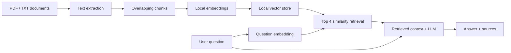

# Employee Policy RAG Assistant

A simple web app that answers questions using PDF or TXT employee policies. The three included policies are **SAMPLE / FICTIONAL**, not real company rules.

**On this computer, dependencies and both models have already been installed. No API key is needed for the default local demo.**

## Start the already-installed app

1. Open the **Ollama** application and leave it running. It supplies the local language model.
2. Open **Terminal** (press Command + Space, type Terminal, then press Return).
3. Paste these lines, one at a time:

```bash
cd /Users/neil/Desktop/week2-rag-project
.venv/bin/python -m streamlit run app.py --server.address 127.0.0.1 --server.port 8501
```

4. Open **http://localhost:8501** in your browser.
5. Ask: **How many PTO days do full-time employees receive per year?**

Leave Terminal open while using the app. Press **Control + C** in Terminal to stop it. You can start it again using the same command. The first answer can take longer while the model loads.

## What RAG means

RAG means **Retrieval-Augmented Generation**. Imagine an assistant that first searches a handbook for useful passages, then reads those passages to answer your question. It does not send the entire handbook to the language model. Each passage becomes a list of numbers, called an embedding, so the app can search by meaning instead of requiring exact words.

```text
Documents
↓
Text extraction
↓
Chunking
↓
Embeddings
↓
Vector store
↓
Similarity retrieval ← Embedded user question
↓
Retrieved context + question → LLM
↓
Grounded answer + sources
```



## Install from scratch on another computer

Skip this section on the computer already set up for you.

1. Install **Python 3.11 or newer** from [python.org](https://www.python.org/downloads/). This project was tested with Python 3.13.15.
2. For free local answers, install [Ollama](https://ollama.com/download), open it, and run this in Terminal:

   ```bash
   ollama pull qwen2.5:3b
   ```

   This downloads approximately 1.9 GB once. If Ollama reports it cannot connect, open its application first. On Linux, run `ollama serve` in a separate terminal.

3. Open Terminal and go into the project folder. On this Mac:

   ```bash
   cd /Users/neil/Desktop/week2-rag-project
   python3 -m venv .venv
   source .venv/bin/activate
   python -m pip install -r requirements.txt
   ```

   On Windows, open PowerShell in the project folder, create the environment with `py -m venv .venv`, then use `.venv\Scripts\python -m pip install -r requirements.txt`. To start the app, use `.venv\Scripts\python -m streamlit run app.py --server.address 127.0.0.1 --server.port 8501`.

4. Start the app using the command at the top. The first document processing downloads the free embedding model (roughly 67 MB of model weights). Keep internet available for installation and initial downloads. Once downloaded, the default local app does not need an external API.

## Optional: use OpenAI instead

Ollama was already installed on this computer, so local generation avoids an account, API key, and per-question API charges. The local model is small and can make mistakes. The app also supports `gpt-4o-mini` through OpenAI's Responses API.

To use OpenAI:

1. Get an API key from [the OpenAI platform](https://platform.openai.com/api-keys). API access requires available API credits; a ChatGPT subscription alone does not provide them.
2. In Terminal, in the project folder, run:

   ```bash
   cp .env.example .env
   open -e .env
   ```

3. Change these two lines in that `.env` file:

   ```dotenv
   LLM_PROVIDER=openai
   OPENAI_API_KEY=your_actual_api_key_here
   ```

4. Save the file, stop Streamlit with Control + C, and start it again. Choose **OpenAI (API key)** in the sidebar if necessary.

The key belongs in `/Users/neil/Desktop/week2-rag-project/.env`, beside `app.py`. Do not put it in the sample documents, code, or screenshots. `.env` is excluded from Git. When using OpenAI, the question and retrieved passages are sent to its API; embeddings and the vector store remain local.

## Add your own documents

1. Put UTF-8 `.txt` files or text-based `.pdf` files directly into the `documents/` folder. Finder can open this folder normally.
2. In the app, click **Process / refresh documents**. Documents are also checked on startup and on UI reruns.
3. The sidebar lists documents that actually yielded readable text. The main screen shows the number loaded.

PDF sources display their original **one-based page number**. TXT sources have no page number. The app shows filename, chunk identifier, and the exact quote used by the model. The expandable retrieved-passages section shows all four search results, including when the answer is unsupported.

Remove the sample TXT files if you want to ask only about your real documents. If the folder has no PDF/TXT files, the app creates the three fictional samples again. Files are not searched recursively. Scanned image PDFs require OCR first; this small project does not include OCR. Empty or unreadable files produce visible warnings.

## Implementation choices

| Component | Choice | Why |
|---|---|---|
| Interface | Streamlit | A short Python program can provide a complete web UI. |
| PDF extraction | pypdf; UTF-8 reading for TXT | Simple local text extraction; PDF page metadata is preserved. |
| Chunks | At most 900 characters, approximately 150-character overlap; prefer sentence/word boundaries; never cross PDF pages | Small, readable passages fit the embedding model; overlap reduces lost context. |
| Embeddings | FastEmbed `BAAI/bge-small-en-v1.5`, 384 dimensions | Free semantic embeddings running locally on CPU, without a second API key. |
| Vector store | NumPy array in `.cache/vectors.npy`, metadata in `.cache/index.json` | For a small corpus, an exact vector search is simpler than installing a database or FAISS/Chroma. This is a real dense-vector store, not keyword search. |
| Retrieval | Normalize vectors, rank by cosine similarity, return top 4 | Easy to explain and reliable for small collections. |
| Generation | Default: Ollama `qwen2.5:3b`; optional: OpenAI `gpt-4o-mini` | Local model makes the installed demo work without a key; optional API generation uses one key. |
| Grounding | Context-only instructions, explicit refusal, structured answer with verified source IDs and exact quotes | Reduces invented answers and catches missing/invalid evidence. |

The vector index is rebuilt when document contents, filenames, or chunking settings change. Downloaded models and vectors live in `.cache/`; do not remove that folder before an offline demo. Similarity scores measure relevance, not confidence. No similarity cutoff is used: the LLM must judge whether the retrieved text answers the question. Valid quotes do not guarantee correct reasoning; human review remains necessary.

## Evaluation and submission materials

- `evaluation_questions.md`: 15 questions, including cross-document, ambiguous, and three unsupported questions.
- `evaluation_report.md`: actual answers, retrieved sources, reviewed groundedness, and retrieval scores from the sample run.
- `PROJECT_DOCUMENTATION.md`: plain-English project explanation.
- `DEMO_SCRIPT.md`: a 3–4 minute recording script.
- `evaluate.py`: repeatable evaluation using the same pipeline as the app.

To rerun evaluation:

```bash
cd /Users/neil/Desktop/week2-rag-project
.venv/bin/python evaluate.py
```

This writes raw results to `.cache/evaluation_results.json` and **replaces** `evaluation_report.md` with fresh results and Pending review columns. Review the new answers before assigning Yes/No and quality scores. OpenAI evaluation makes 15 API calls if selected; the default local evaluation is free.

## If something goes wrong

| What you see | What to do |
|---|---|
| Ollama unavailable | Open Ollama, run `ollama pull qwen2.5:3b`, then retry. |
| Browser cannot connect | Start Streamlit and leave its Terminal open. Check that port 8501 is free. |
| No text found in PDF | Use a text-based PDF or convert the scan to searchable text with OCR first. |
| Invalid source quote/labels | Retry or rephrase; the app refuses to display an unverifiable answer. |
| OpenAI request fails | Check the key, credits, connection, and model access; or choose Ollama. |
| Module not found | Use `.venv/bin/python` in the exact startup command, or install requirements in that environment. |

## Files

```text
week2-rag-project/
    app.py
    evaluate.py
    requirements.txt
    .env.example
    .gitignore
    README.md
    documents/                    # 3 fictional TXT policies; add PDF/TXT here
    evaluation_questions.md
    evaluation_report.md
    PROJECT_DOCUMENTATION.md
    DEMO_SCRIPT.md
    .cache/                       # generated models, vectors, metadata, evaluation
    .venv/                        # installed Python dependencies
```

Implementation references: [FastEmbed documentation](https://qdrant.github.io/fastembed/Getting%20Started/), [Ollama generation API](https://docs.ollama.com/api/generate), and [OpenAI structured outputs](https://developers.openai.com/api/docs/guides/structured-outputs).
